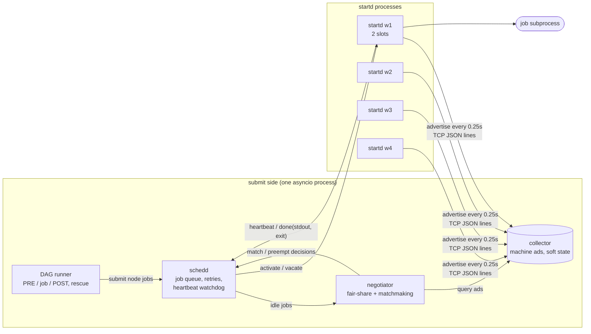

# matchmaker-grid

A high-throughput computing lab built as a classic high-throughput matchmaking scheduler: a resource-ad expression language, symmetric matchmaking between jobs and machines, a fair-share negotiator, and DAG workflows running real work on a pool of local worker processes.


## What it demonstrates

- **Resource-ad language**: a hand-written tokenizer, a recursive-descent parser and a tree-walking evaluator. It supports three-valued logic (true, false, UNDEFINED, plus ERROR), `MY.` / `TARGET.` scoping, arithmetic, comparisons, `=?=` / `=!=` meta-equality, the ternary operator, lists, a small set of builtins (`member`, `strcat`, `size`, `ifThenElse`, `isUndefined`, `isError`, `regexp`, `toLower`, `toUpper`) and a pretty printer that round-trips.
- **Symmetric matchmaking**: a job and a machine match only when *both* Requirements expressions are exactly `true`. Each side ranks the other with `Rank`. A diagnostic splits a job's Requirements into `&&` clauses and shows how many machines each clause rejects, and why (false or undefined).
- **Negotiator with fair-share**: user priorities decay exponentially with a configurable half-life. The pool is split in inverse proportion to effective priority, quotas act as hard caps, and the scheduler is work-conserving. A claim is preempted only when the machine's `PreemptionRequirements` policy allows it and the victim is above its own share.
- **Pool runtime on asyncio**: a collector holds machine ads as soft state over TCP with JSON lines. `startd` worker *processes* run real subprocess jobs with stdout capture and exit codes. A `schedd` handles retries, heartbeats and lost-worker rescheduling, and preemption with checkpoint/resume for a long-running job type.
- **DAG workflows**: parent/child dependencies, per-node retries, PRE/POST scripts (POST sees `$RETURN` and decides the outcome), and numbered rescue files that resume a failed DAG without redoing finished nodes.
- **An end-to-end demo**: 4 workers, 40 jobs from 3 users and a map-reduce DAG. It also injects faults: a frozen worker, a flaky job, an unsatisfiable job and a gated DAG node.

## Architecture



Startds push their machine ads to the collector. The negotiator pulls those ads and the schedd's idle queue each cycle, and turns them into decisions with a pure function (`Negotiator.cycle`). The schedd acts on each decision by opening an activation connection to the chosen startd. That connection carries the whole claim: `activate`, `accepted`, periodic `heartbeat`, then `done` with stdout and the exit code. The schedd can send `vacate` at any time to preempt. If heartbeats stop, the schedd marks the job lost, quarantines that machine for a few seconds, and the job goes back to idle. The collector also drops the machine's ads once they stop being refreshed.

Source layout: `ads/` holds the language (lexer, parser, printer, evaluator, `Ad`). `matchmaking.py`, `fairshare.py` and `negotiator.py` hold the policy as pure functions. `collector.py`, `startd.py`, `schedd.py` and `pool.py` are the runtime, `dag.py` runs workflows and `workloads.py` holds the job payloads.

## Quickstart

```bash
python3 -m venv .venv && . .venv/bin/activate
pip install -e ".[dev]"

# expression language
matchmaker eval 'MY.Memory > 2048 && TARGET.OpSys == "LINUX"' --my '[Memory = 4096]' --target '[OpSys = "linux"]'
matchmaker eval 'MY.Memory > 2048 && TARGET.OpSys == "LINUX"' --my '[Memory = 4096]'   # -> undefined
matchmaker format '[Requirements = (TARGET.Memory >= 1024) && ((TARGET.Gpus =?= undefined) || TARGET.Gpus > 0)]'
matchmaker match '[Name="j"; RequestMemory=2048; Requirements = TARGET.Memory >= MY.RequestMemory && TARGET.Gpus >= 1]' \
    '[Name="m1"; Memory=4096]' '[Name="m2"; Memory=8192; Gpus=1]'

# full pool demo (about 20 s), or the smaller variant used by CI
matchmaker-grid demo
matchmaker-grid demo --quick

# checks, exactly as CI runs them
ruff check .
pytest
```

The demo prints match and preemption decisions as they happen, a fair-share table every two seconds, the diagnostic for the unsatisfiable job, retry and lost-worker events, and the DAG run (first attempt, rescue file, resumed run). It ends with a JSON summary.

## Design decisions

1. **Pull-based matchmaking, not push scheduling.**
   *Decision*: workers advertise what they offer, jobs state what they need, and a periodic negotiator pairs them. There is no central scheduler that assigns work to machines.
   *Why*: each machine owner keeps control through their own Requirements, Rank and preemption policy, written in the same language as the jobs. The negotiator never has to model machine policy, and adding a machine is just one more ad. Because the cycle is a pure function of (ads, queue, clock), every policy decision can be unit tested without sockets.
   *Trade-off*: latency is bounded below by the cycle period (250 ms here), and the negotiator decides on ads that may be slightly stale. The startd therefore re-checks the match on activation and can reject it, which costs one extra round trip.

2. **Three-valued logic plus ERROR, with non-strict `&&` / `||`.**
   *Decision*: a missing attribute evaluates to UNDEFINED. Strict operators propagate it, ERROR dominates UNDEFINED, and only an exact `true` counts as a match. `false && undefined` is `false` and `true || undefined` is `true`. `=?=` compares type and value and never returns UNDEFINED.
   *Why*: ads come from many sources, so missing attributes are the normal case, not an exception. A two-valued evaluator would have to treat "unknown" as false (silently hiding typos) or as an exception (one bad ad breaks the cycle). With UNDEFINED, `TARGET.Gpus >= 1` simply does not match a machine without GPUs. A policy can still say `TARGET.Gpus =?= undefined || TARGET.Gpus > 0` explicitly, and the diagnostic can tell "false on 2 machines" apart from "undefined on 6".
   *Trade-off*: authors have to learn that `!(x > 3)` is not "x is at most 3" when x is missing, and Python's `bool()` cannot be used on results. The sentinels raise on truthiness to keep that mistake out of the codebase.

3. **Fair-share as an exponentially decayed usage integral.**
   *Decision*: real priority follows `p = beta*p + (1-beta)*cores` with `beta = 0.5^(dt/half_life)`, with a floor of 0.5. Shares are inversely proportional to priority, a quota caps a user, and a second pass hands out any leftover slots.
   *Why*: it needs O(1) state per user, its result does not depend on how often the negotiator samples (a test checks this), and it has a single meaningful knob: how long the pool remembers heavy use. The work-conserving pass means fairness never costs utilisation.
   *Trade-off*: fractional shares have to be rounded to whole slots. The code rounds up for both the candidate and the victim, so both sides agree on what "within share" means. A user with a burst of short jobs can therefore slightly exceed their share within a cycle.

4. **Preemption has to pass three gates.**
   *Decision*: a claim is preempted only if the machine's `PreemptionRequirements` (evaluated with `RemoteUserPrio` and `SubmitterUserPrio` injected) is true, the victim is above its own rounded share, and the victim's priority is worse by a margin (1.2x). Checkpointing victims are evicted first, and each cycle allows at most N preemptions.
   *Why*: an unguarded preemption policy can thrash, with two users evicting each other every cycle. The margin and the share check remove that oscillation, and the per-cycle cap limits how much work is lost at once. Putting the policy in the machine ad lets an owner say, for example, "my group's jobs may always preempt here".
   *Trade-off*: a newly arrived user can wait a few cycles for their fair share instead of getting it immediately.

5. **One TCP connection per claim, with heartbeats as the liveness signal.**
   *Decision*: an activation is a dedicated connection that carries the start, the heartbeats, an optional vacate and the result. Missing heartbeats past a timeout, or EOF without `done`, mark the job lost. It is requeued without spending a retry, and the machine is quarantined briefly.
   *Why*: lost-worker detection does not depend on the collector, which has its own soft-state expiry. The demo freezes a worker with SIGSTOP, so its sockets stay open and only the heartbeat timeout can catch it, which is the failure TCP alone does not detect. Lost runs and failed runs are counted separately, because a broken machine should not use up a job's retries.
   *Trade-off*: delivery is at-least-once. A frozen worker that wakes up could finish a job that has already been rescheduled. Real systems fence this with claim IDs or leases, and here the startd is killed after being declared lost.

6. **Checkpoints are a job-side contract.**
   *Decision*: the schedd gives a checkpointing job a stable `MATCHMAKER_CHECKPOINT` path, and the job writes it atomically (temp file plus rename) after every chunk and on SIGTERM. Each chunk is seeded independently, so a resumed run produces bit-identical results to an uninterrupted one.
   *Why*: the scheduler stays unaware of application state, and vacate (SIGTERM, then a grace period, then SIGKILL) becomes cheap for these jobs. That is why the negotiator prefers them as preemption victims.
   *Trade-off*: it only works for jobs written to the contract, and the checkpoint lives on a shared local disk. On a real cluster that means shared storage or a transfer step.

## Scope and limits

- All processes run on one host. There is no authentication, encryption or file transfer, and jobs share the submit directory.
- Slots are static (one core each). There are no partitionable slots, no slot splitting, and no draining or defragmentation.
- Single schedd and single negotiator. Accounting lives in memory, so a restart forgets priorities and the queue (there is no job queue log).
- The language covers the subset needed for matchmaking: no nested ads as values, no attribute selection on lists, no time or string-list functions.
- No claim reuse: every job is a fresh match. Real pools keep a claim and run several jobs from the same user on it.
- The DAG runner covers dependencies, retries, PRE/POST and rescue. There are no sub-DAGs, splices, variables or node priorities.

## About this lab

A compact reference implementation written in 2026. It reconstructs, on synthetic data, patterns I have used in production systems (declarative resource matching, fair-share scheduling, fault-tolerant distributed job execution and workflow orchestration), without reproducing any proprietary design.

## License

MIT, see [LICENSE](LICENSE).
